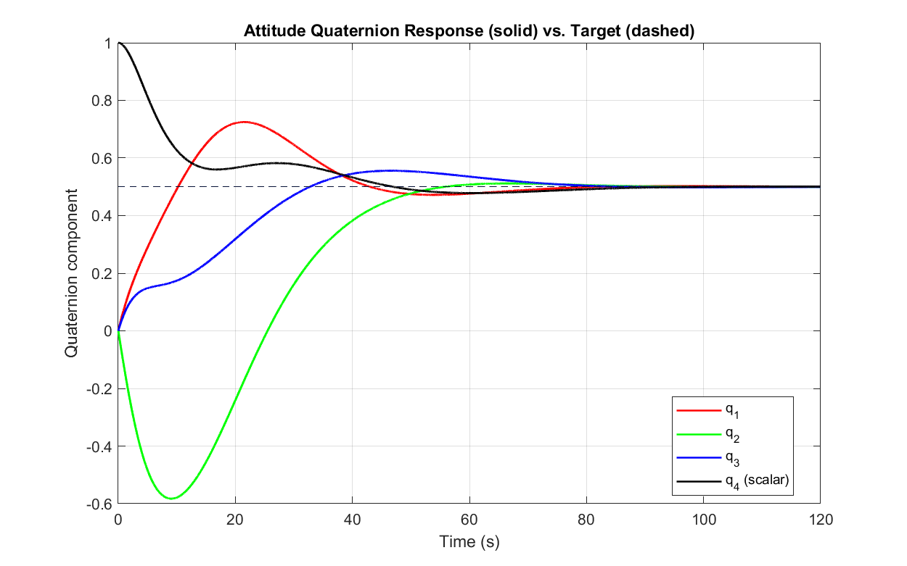

# CubeSat Attitude Determination and Control

MATLAB simulation of attitude control for a 3U CubeSat. After deployment the
satellite is tumbling, and the controller has to stop the rotation and turn it
to a target attitude. Attitude is described with quaternions, the controller
is a quaternion error PD law with torque saturation, and the equations are
integrated with my own RK4 code, checked against `ode45`.

In the second part the attitude is estimated from noisy sun sensor and
magnetometer vectors with the TRIAD method.

Full report: [Documentation/report/report.pdf](Documentation/report/report.pdf)

## Main results

| | Value |
|---|---|
| Settling time | 74.1 s |
| Final attitude error, norm of eps_e | 9.6e-4 |
| Peak wheel torque | 1.0 mN m (limit, reached only at the start) |
| Quaternion norm error | 2.2e-16 |
| RK4 vs ode45, max difference | 1.3e-4 deg |
| TRIAD attitude error (RMS) | 0.60 deg |



## Spacecraft and scenario

| Parameter | Value |
|---|---|
| Size and mass | 3U (0.1 x 0.1 x 0.3 m), 4.0 kg |
| Inertia | diag(0.0333, 0.0333, 0.00667) kg m^2 |
| Initial rates | (10, -15, 8) deg/s |
| Target attitude | 120 deg about (1,1,1)/sqrt(3) |
| Torque limit | 1 mN m per axis |
| Gains | Kp = 6.0e-4 N m, Kd = 4.4e-3 N m s |
| Simulation | 120 s, step 0.01 s |

## How to run

Open the `MATLAB` folder in MATLAB and run

```
main_simulation
```

Figures are saved to `Figures/` and a summary to `Results/`.

Other scripts:

- `compare_gain_designs` - compares the baseline gains with per-axis gains
  (per-axis: 78.8 s settling, baseline: 74.1 s)
- `determination_demo` - TRIAD attitude estimation with noisy sensors

## Files

| File | Description |
|---|---|
| `cubesat_params.m` | mass, inertia, gains and scenario |
| `attitude_dynamics.m` | quaternion kinematics and Euler equations |
| `pd_controller.m` | PD control law with saturation |
| `rk4_integrator.m` | RK4 integrator with quaternion normalization |
| `quat_to_dcm.m`, `quat_to_euler321.m`, `skew.m` | helper functions |
| `sensor_model.m` | noisy sun and magnetic field vectors |
| `triad.m` | TRIAD method |
| `main_simulation.m` | main script |

## Limitations

- No disturbance torques (gravity gradient, drag, solar pressure).
- Reaction wheels are modeled only as a torque limit.
- The TRIAD estimate is not used by the controller (open loop).
- Only one initial condition, no Monte Carlo runs.

## License

MIT, see [LICENSE](LICENSE).
